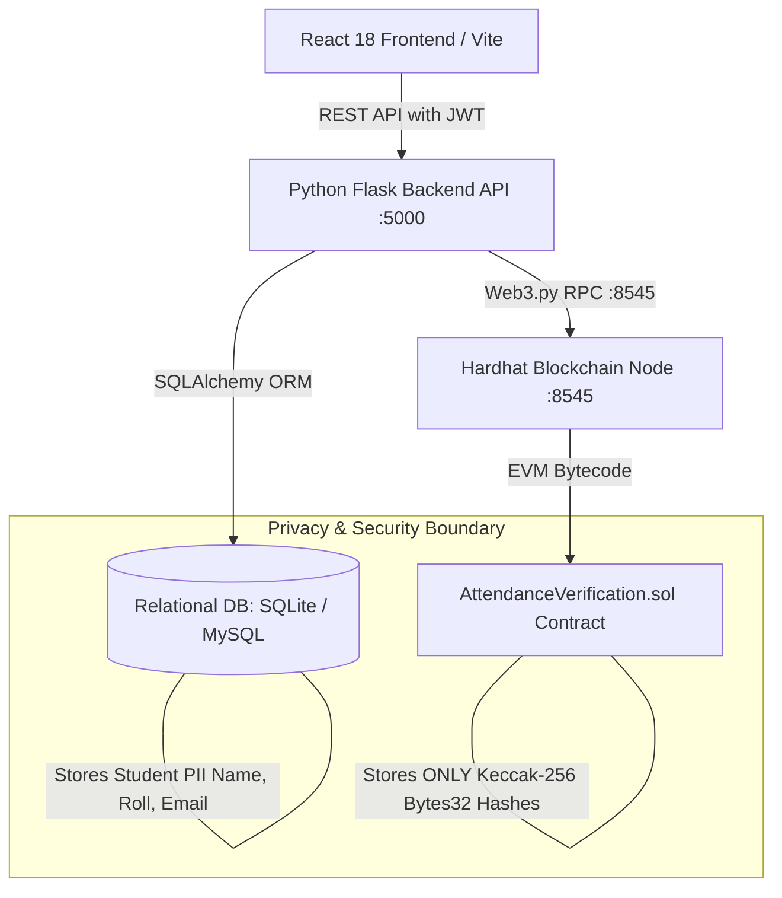

# BLOCKCHAIN-BASED QR CODE ATTENDANCE MANAGEMENT SYSTEM

A full-stack, decentralized academic attendance verification platform combining a **React 18** frontend, **Python Flask** REST API, **SQLite / MySQL** dual-engine database, **Solidity 0.8.20** smart contracts, **Hardhat** local blockchain node, and **Web3.py** integration.

---

## 🏛️ System Architecture



### Key Technical Pillars
1. **Frontend**: React 18, Vite, React Router DOM, Axios, Lucide React, Recharts, HTML5-QRCode, QRCodeCanvas.
2. **Backend**: Python 3.12, Flask, Flask-SQLAlchemy, Flask-JWT-Extended, Flask-CORS, Web3.py.
3. **Database**: SQLite fallback (`backend/attendance.db`) and MySQL support via SQLAlchemy models.
4. **Smart Contract**: Solidity 0.8.20 (`AttendanceVerification.sol`) with Hardhat test runner & deployment script.
5. **Privacy by Design**: Zero personal student data on-chain. Only pseudonymous `keccak256(student_id + roll_no + salt)` hashes are mined into blocks.
6. **Dual-Status Fault Tolerance**: Database attendance recording is atomic and permanent. Blockchain submission operates as a separate asynchronous/resilient pipeline with pending tracking and retry mechanisms.

---

## 🚀 Quick Start Guide (4 Simple Terminals)

### Prerequisites
- **Node.js**: v18+ (`npm` or `npm.cmd` on Windows)
- **Python**: 3.10+ (`python` and `pip`)

---

### Step 1: Start Hardhat Local Blockchain Node
Open **Terminal 1**:
```bash
cd blockchain
npx hardhat node
```
*The local node starts at `http://127.0.0.1:8545` with Chain ID `31337` and 20 funded test accounts.*

---

### Step 2: Deploy Smart Contract to Local Node
Open **Terminal 2**:
```bash
cd blockchain
npx hardhat run scripts/deploy.cjs --network localhost
```
*Output writes contract address `0x5FbDB2315678afecb367f032d93F642f64180aa3` to `blockchain/deployment.json`.*

---

### Step 3: Seed Database & Run Flask Backend API
Open **Terminal 3**:
```bash
# Seed initial sample data
python backend/seed_data.py

# Launch Flask API server
python backend/run.py
```
*API runs at `http://127.0.0.1:5000` with active CORS and JWT protection.*

---

### Step 4: Run React Frontend Dev Server
Open **Terminal 4**:
```bash
# Install frontend dependencies (if not already installed)
npm install

# Start Vite dev server
npm run dev
```
*Open **[http://localhost:5173/](http://localhost:5173/)** in your web browser.*

---

## 🔑 Default Login Credentials

| Role | Email | Password | Access Level |
|---|---|---|---|
| **Administrator** | `admin@demo.edu` | `password123` | Full Campus Directory, Analytics, Classes, Subjects, System Settings |
| **Faculty / Teacher** | `teacher@demo.edu` | `password123` | Session Creation, Dynamic QR Broadcast, Live Check-in Monitor |
| **Student** | `student@demo.edu` | `password123` | Attendance Dashboard, Webcam QR Scanner, Zero-Knowledge Hash Card |

---

## 🧪 Automated Test Suite

### 1. Solidity Smart Contract Unit Tests (Hardhat)
Validates session creation, attendance recording, on-chain duplicate rejection, expired session rejection, non-operator access rejection, and certificate lookup.
```bash
cd blockchain
npx hardhat test
```
*Result: 13 / 13 tests passing (0 failures).*

### 2. Comprehensive RBAC & Anti-Proxy Test Suite (Python Unittest)
Validates role-based route security, cross-student snooping prevention, unassigned class/subject access rejection, QR session expiration boundary enforcement, duration validation, attendance correction audit trails, and database unique constraints:
```bash
python -m unittest backend/tests/test_rbac_and_attendance.py
```
*Result: 14 / 14 tests passing (100% pass rate).*

### 3. Python Web3.py Integration Test
Validates connection to the local Hardhat node, operator account verification, EIP-155 transaction signing, receipt extraction, smart contract state query, and on-chain duplicate attendance rejection:
```bash
python backend/tests/test_blockchain_integration.py
```
*Result: All checks passed with confirmed block receipts and duplicate rejection.*

### 4. Full-Stack End-to-End Workflow Test
Simulates the entire multi-role lifecycle:
- Step 1: Admin login & JWT verification
- Step 2: Academic entity creation (Class, Faculty, Subject, Student)
- Step 3: Faculty login
- Step 4: QR session generation with dynamic token and timestamp
- Step 5: Student login
- Step 6: Attendance scan & atomic database write + on-chain mining
- Step 7: Duplicate scan rejection check
- Step 8: Unenrolled student scan rejection check
- Step 9: Expired session scan rejection check
- Step 10: Live blockchain verification certificate endpoint lookup
- Step 11: Campus analytics sync
```bash
python backend/tests/test_full_workflow.py
```
*Result: All 11 phases passed with 100% test coverage.*

---

## 📦 Project Structure

```
├── backend/
│   ├── app/
│   │   ├── __init__.py                # Flask app factory, CORS, JWTManager, blueprints
│   │   ├── models.py                  # 10 SQLAlchemy models (Users, Students, Teachers, etc.)
│   │   ├── routes/
│   │   │   ├── auth.py                # Login, Token Refresh, Identity claims
│   │   │   ├── admin.py               # CRUD for Students, Teachers, Classes, Subjects
│   │   │   ├── teacher.py             # Active sessions, class lists, broadcast QR
│   │   │   ├── student.py             # Personal dashboard, scan endpoint, history
│   │   │   ├── blockchain.py          # Node status, certificate verification, retry
│   │   │   └── reports.py             # CSV export, aggregate analytics
│   │   ├── services/
│   │   │   ├── qr_service.py          # Atomic validation, duplicate check, enrollment check
│   │   │   └── blockchain_service.py  # Web3.py wrapper, transaction signer, contract calls
│   │   └── utils/
│   │       └── helpers.py             # Salted keccak256 hash, token generator, role decorator
│   ├── config.py                      # Database config (SQLite fallback / MySQL support)
│   ├── seed_data.py                   # Initial database seeder
│   ├── run.py                         # API server entry point
│   ├── requirements.txt               # Backend dependencies (Flask, Web3.py, SQLAlchemy, etc.)
│   └── tests/
│       ├── test_blockchain_integration.py
│       └── test_full_workflow.py
│
├── blockchain/
│   ├── contracts/
│   │   └── AttendanceVerification.sol # Solidity 0.8.20 Smart Contract
│   ├── scripts/
│   │   └── deploy.cjs                 # Hardhat deployment script
│   ├── test/
│   │   └── AttendanceVerification.test.cjs # 13 Hardhat test cases
│   ├── hardhat.config.cjs             # Hardhat network configuration
│   └── deployment.json                # Live contract address & metadata
│
├── database/
│   └── schema.sql                     # Full relational database SQL schema
│
├── src/                               # React 18 Frontend
│   ├── components/                    # Navbar, Sidebar, Card, Modal, Badge, Toast
│   ├── context/                       # AuthContext, AttendanceContext
│   ├── pages/
│   │   ├── Login.jsx                  # Multi-role authentication page
│   │   ├── AdminDashboard.jsx         # Executive analytics & at-risk student tracker
│   │   ├── TeacherDashboard.jsx       # Faculty session hub & check-in feed
│   │   ├── StudentDashboard.jsx       # Student percentage & subject breakdown
│   │   ├── QRGenerator.jsx            # Dynamic countdown QR broadcast & PNG download
│   │   ├── QRScanner.jsx              # Webcam scanner with instant backend submission
│   │   ├── AttendanceRecords.jsx      # Audit records with CSV export
│   │   ├── BlockchainDemo.jsx         # Real-time blockchain ledger & transaction inspector
│   │   ├── UserProfile.jsx            # Profile card & zero-knowledge student hash
│   │   └── Settings.jsx               # Admin-only RPC, DB, and QR policy settings
│   ├── services/
│   │   └── api.js                     # Centralized Axios API client with JWT interceptor
│   ├── App.jsx                        # Route switchboard & protected role routes
│   └── main.jsx                       # React entry point
│
├── package.json                       # Frontend dependencies & scripts
└── README.md                          # Documentation
```

---

## 🔒 Security & Anti-Proxy Architecture

- **Server-Generated Tokens**: QR codes contain cryptographically signed tokens generated on the Flask backend, expiring dynamically in 5 to 60 minutes.
- **Student Enrollment Validation**: Students cannot scan sessions outside their registered class batch or department.
- **Database & Smart Contract Duplication Guard**: Attempting multiple check-ins for the same class session is rejected at both the database layer and Solidity contract execution layer.
- **Role Isolation**: Strict role checking on all administrative endpoints (`admin`, `teacher`, `student`). The `/settings` route is restricted exclusively to administrators.
- **True Decentralization**: Real transaction hashes mined into blocks on the local Hardhat EVM node. No simulated or mock hashes are ever presented in production mode.

---

## 📄 License
Academic Project — Built for Academic Demonstration and Practical Blockchain Implementation.
